<!--
  GitHub Profile README
  https://github.com/bhargavak04
-->

<table>
<tr>
<td width="62%" valign="middle">

# Hey, I'm Bhargav 👾

### Building cool stuff. Breaking things. Fixing them with AI.

I'm a **Junior Software Developer** interested in AI systems, backend engineering, automation and building useful products.

I enjoy connecting things that weren't originally designed to work together.

- 🤖 Building AI-powered applications and MCP integrations
- ⚙️ Automating workflows and repetitive processes
- 🔧 Working with backend systems, APIs and databases
- 🎮 Exploring game development and other interesting side projects
- 🧠 Always experimenting with something new

**Current status:** Probably debugging something.

</td>
<td width="38%" align="center" valign="middle">

 

I'm not lazy. I'm just conserving energy.

</td>
</tr>
</table>

## ⚡ Tech Arsenal

**Languages & Backend**

**AI & Automation**

**Databases & Infrastructure**

**Frontend & Tools**

---

## 💼 Work Experience

### Junior Software Developer · Sportomic

*July 2026 – Present*

Working on production applications involving backend development, AI integrations, messaging automation and cloud infrastructure.

- Developing backend services and AI-powered integrations.
- Building automation workflows and messaging-based applications.
- Working with MCP, Node.js, Python and databases.
- Contributing to production systems and platform improvements.

### Software Development Intern · Sportomic

*June 2025 – June 2026*

- Worked on AI automation and software development.
- Built automation workflows and integrations.
- Contributed to messaging-based booking experiences and internal tools.

---

## 🚀 Projects

| Project | Description |
|---|---|
| [AI Help Bot for MOSDAC](https://github.com/bhargavak04/SSIP_RAG_MultiModal) | Multimodal RAG-based AI help bot |
| [Artemis Task Manager](https://github.com/bhargavak04/Artemis-TaskManager) | Task management application |
| [Speaker Identification & Emotion Detection](https://github.com/bhargavak04/Speaker-Identification-Emotion-Detection) | Audio analysis and emotion detection |
| [FinGuide Agent](https://github.com/Team-Perceptrons/FinGuide_agent) | AI-powered financial guidance project |

---

## 📊 GitHub Stats

---

## 👾 Pac-Man is eating my contributions

---

## 🌐 Find me around the internet

### Thanks for visiting! ⭐

